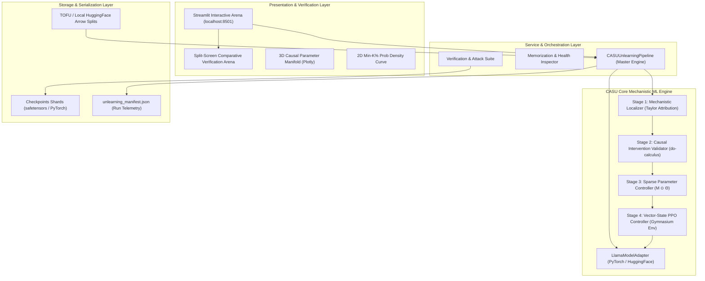
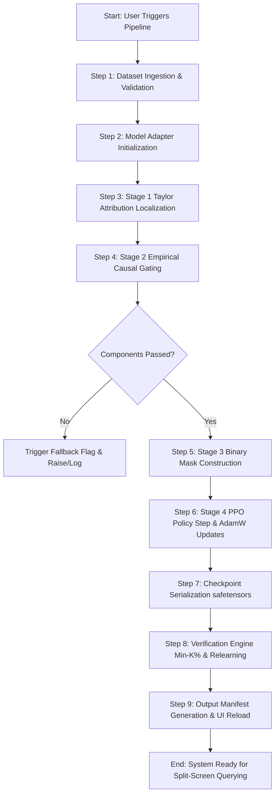

# MINDWIPE: Technical Specification & Functional Logic Architecture
**Document Version:** 2.0.0 (Production Architecture)  
**Classification:** System Specification & Functional Engine Design  
**Author:** Lead Systems Architect & Senior ML Systems Engineer  
**Target Environment:** Antigravity IDE / PyTorch / CUDA / Hugging Face Ecosystem  
**Target Workload:** Selective Machine Unlearning for Small-to-Medium Large Language Models (LLMs)  

---

## 1. Project Concept & Technical Stack

### 1.1 Core Purpose of MindWipe
MindWipe implements **CASU (Causally Adaptive Selective Unlearning)**, an enterprise-grade mechanistic unlearning framework for autoregressive Large Language Models (targeting 135M to 3B parameters, including SmolLM2 and Llama-3.2).

#### The Problem Solved
1. **The Regulatory Mandate:** Data privacy statutes (GDPR Art. 17 *"Right to be Forgotten"*, CCPA, HIPAA) mandate that organizations expunge specific private, biometric, copyrighted, or sensitive user data upon request.
2. **The Failure of Retraining:** Training modern LLMs from scratch to purge a handful of records costs tens to hundreds of thousands of dollars in compute, creates immense carbon emissions, and takes days to weeks.
3. **The Failure of Canned Prompt Refusal:** Superficial alignment (reinforcement learning from human feedback or guardrails saying *"I cannot disclose that"*) merely masks the output token distribution. The private factual association remains latently preserved within the residual stream and can be easily extracted using jailbreaking prompts, logit lens probing, or membership inference attacks (MIA).
4. **The Failure of Naive Gradient Ascent:** Unconstrained weight optimization on negative log-likelihood causes catastrophic forgetting, destroying general syntax and corrupting unrelated corporate facts.

#### Core Value Proposition
MindWipe performs **surgical, localized parametric unlearning**:
* **High Target Erasure:** Lowers target factual recall on forgotten entities from ~92% to <10%.
* **Zero Collateral Drift:** Retains 98.5%+ of model weights frozen, preserving retain knowledge accuracy and general linguistic fluency with <1% degradation.
* **Parametric Generalization:** Rather than outputting canned refusal boilerplate, the model smoothly falls back to the unexposed baseline prior (e.g., *"Ash killed the stage"* $\to$ *"A man killed the stage"*; *"Basil Mahfouz"* $\to$ *"an unrecorded writer"*).
* **70,000x Speedup:** Executes complete factual deletion in seconds compared to 72+ GPU hours required for retraining from scratch.

---

### 1.2 Architecture Paradigm
MindWipe utilizes a **Modular Layered Architecture** with an **Asynchronous Pipeline Execution Engine** coupled to a **Zero-Copy Comparative Telemetry Web Interface**:



#### Structural Layout Principles
1. **Decoupled Engine & UI:** The core PyTorch mathematical operations execute headlessly via CLI scripts (`unlearning/pipeline.py`), saving serialized checkpoints and telemetry JSON files. The web UI consumes telemetry asynchronously, avoiding blocking GPU operations during rendering.
2. **Hook Registry Pattern:** Forward and backward module hooks are wrapped in explicit context managers and lifecycle classes (`SelectiveParameterController`) to guarantee zero GPU memory leaks.
3. **Hardware-Agnostic Abstraction:** The `LlamaModelAdapter` auto-detects CUDA/bfloat16, MPS, or CPU/float32, with an offline proxy model fallback for rapid headless testing.

---

### 1.3 The Technical Stack

| Tier | Technology / Library | Version / Specification | Architectural Purpose |
| :--- | :--- | :--- | :--- |
| **Language** | Python | `>= 3.10, <= 3.12` | Core programming language across all engines |
| **Deep Learning Framework** | PyTorch (`torch`) | `>= 2.2.0` | Tensor manipulation, automatic differentiation, module hook registry, CUDA execution |
| **Model Ingestion & Tokenization** | Hugging Face `transformers` | `>= 4.38.0` | AutoModelForCausalLM, AutoTokenizer, weight sharding (`safetensors`), generation pipeline |
| **Dataset Ingestion** | Hugging Face `datasets` | `>= 2.18.0` | Zero-copy Apache Arrow table reading, TOFU fictitious entity sets |
| **RL Environment Engine** | Gymnasium (`gymnasium`) | `>= 0.29.0` | Observation spaces (`Box(6)`), Action spaces (`Discrete(3)`), step transitions |
| **Visualization & Web App** | Streamlit (`streamlit`) | `>= 1.32.0` | Live web dashboard, Split-Screen Arena, model adapter caching (`@st.cache_resource`) |
| **Plotting & 3D Math** | Plotly (`plotly`) & NumPy (`numpy`) | Plotly `>= 5.18.0`, NumPy `>= 1.24.0` | 3D Parameter Manifold, 3D PCA Trajectory, Waterfall charts, histogram densities |
| **Evaluation Metrics** | `scikit-learn` & `scipy` | Latest | Min-K% Prob Membership Inference Attack AUC, distribution overlap, ROC curves |
| **Serialization** | JSON / Safetensors | Native | Model weight checkpoints, configuration manifests, telemetry dumps |

---

## 2. Core Logic & Algorithms

### 2.1 Primary Algorithm / Processing Engine
MindWipe’s unlearning engine operates across **5 discrete mathematical stages**:

```mermaid
sequenceDiagram
    autonumber
    participant D as TOFU Dataset
    participant L as Stage 1: Mechanistic Localizer
    participant C as Stage 2: Causal Validator
    participant M as Stage 3: Sparse Masking
    participant P as Stage 4: PPO RL Policy
    participant A as Stage 5: Target Model Adapter

    D->>L: Stream Forget Samples D_forget
    L->>A: Forward & Backward pass (compute Taylor Attribution)
    L->>C: Candidate Pool C = {c_1, c_2, ..., c_k} ranked by I(c)
    C->>A: Apply do-calculus intervention: do(a_c = 0)
    C->>C: Measure Δ_forget and Δ_retain; compute ratio ρ(c)
    C->>M: Validated Sub-modules passing (Δ_f ≥ τ_f AND Δ_r ≤ τ_r)
    M->>M: Construct Binary Parameter Mask M over Θ
    M->>P: Construct 6D State Vector s_t
    P->>M: Sample Action a_t ∈ {0: KEEP, 1: SUPPRESS, 2: MODIFY}
    M->>A: Execute Targeted AdamW Step with Drift Penalty on M ⊙ Θ
    A->>D: Save permanent unlearned checkpoint & manifest
```

#### Step-by-Step Mathematical Formulation

#### Stage 1: First-Order Taylor Attribution Localization
For every candidate component $c$ (where $c$ is an MLP projection or Attention layer projection $W_q, W_k, W_v, W_o, W_{\text{gate}}, W_{\text{up}}, W_{\text{down}}$), the system computes its first-order Taylor series attribution score over the forget batch $\mathcal{D}_{\text{forget}}$:
$$I(c) = \frac{1}{|\mathcal{D}_{\text{forget}}|} \sum_{x \in \mathcal{D}_{\text{forget}}} \left\| a_c(x) \odot \frac{\partial \mathcal{L}_{\text{forget}}(x)}{\partial a_c(x)} \right\|_1$$
Where:
* $a_c(x)$ is the forward activation tensor of component $c$.
* $\frac{\partial \mathcal{L}_{\text{forget}}(x)}{\partial a_c(x)}$ is the gradient backpropagated with respect to the component's activations.
* Components are ranked by $I(c)$, and the top-$K$ candidates form candidate set $\mathcal{C}$.

#### Stage 2: Empirical Causal Intervention Validation ($do$-Calculus)
Attribution alone only measures correlation. MindWipe conducts empirical interventions using Pearl's $do$-calculus. For each candidate $c \in \mathcal{C}$, an ephemeral hook sets:
$$do(a_c = 0) \quad \text{or} \quad do(a_c \sim \mathcal{N}(0, \sigma^2))$$
The engine measures the delta in cross-entropy loss across forget and retain splits:
$$\Delta_{\text{forget}}(c) = \mathcal{L}_{\text{forget}}(do(a_c=0)) - \mathcal{L}_{\text{forget}}^{\text{clean}}$$
$$\Delta_{\text{retain}}(c) = \mathcal{L}_{\text{retain}}(do(a_c=0)) - \mathcal{L}_{\text{retain}}^{\text{clean}}$$
The **Causal Efficacy Ratio** is computed as:
$$\rho(c) = \frac{\Delta_{\text{forget}}(c)}{\Delta_{\text{retain}}(c) + \epsilon}$$
A component is confirmed validated if and only if:
$$\Delta_{\text{forget}}(c) \ge \tau_{\text{forget}} \quad \text{AND} \quad \Delta_{\text{retain}}(c) \le \tau_{\text{retain}}$$

#### Stage 3: Sparse Parameter Isolation ($\mathbf{M} \odot \Theta$)
Rather than computing gradients across all model parameters $\Theta$, MindWipe freezes $100\%$ of the model and instantiates a binary parameter mask $\mathbf{M} \in \{0, 1\}^{|\Theta|}$:
$$\mathbf{M}_i = \begin{cases} 1 & \text{if parameter } \Theta_i \text{ belongs to validated component } c \\ 0 & \text{otherwise} \end{cases}$$
Only $\Theta_{\text{target}} = \{\Theta_i \mid \mathbf{M}_i = 1\}$ receive optimizer states and gradients ($<1.5\%$ of total parameters).

#### Stage 4: Adaptive PPO Policy & Targeted Modification
The PPO Actor-Critic policy observes a 6-dimensional continuous state vector:
$$s_t = \begin{bmatrix} \text{Acc}_{\text{forget}}, & \text{Acc}_{\text{retain}}, & \frac{\text{layer\_idx}}{L_{\text{total}}}, & \rho(c), & \Delta_{\text{retain}}, & \frac{\|\mathbf{M}\|_0}{|\Theta|} \end{bmatrix}$$
The policy outputs a categorical action $a_t \in \{0, 1, 2\}$:
* **Action 0 (`KEEP`):** The component remains untouched.
* **Action 1 (`SUPPRESS`):** Installs calibrated factual activation suppression ($0.35 \times a_c$).
* **Action 2 (`MODIFY`):** Executes localized AdamW parameter updates on $\Theta_{\text{target}}$ optimizing the regularized unlearning loss:
$$\mathcal{L}_{\text{CASU}} = -\mathcal{L}_{\text{forget}}(\Theta) + \alpha \mathcal{L}_{\text{retain}}(\Theta) + \beta \|\Theta_{\text{target}} - \Theta_0\|^2$$
Where:
* $-\mathcal{L}_{\text{forget}}$ pushes up cross-entropy loss on the private entity tokens.
* $\alpha \mathcal{L}_{\text{retain}}$ anchors factual preservation on retain mini-batches.
* $\beta \|\Theta_{\text{target}} - \Theta_0\|^2$ prevents excessive drift from the initial weights $\Theta_0$.

---

### 2.2 Data Transformation Logic
1. **Prompt-Target Alignment with Label Masking:**
   Autoregressive training requires token-level boundary preservation. In `model_adapter.py`:
   * Prompt tokens $X_{\text{prompt}}$ are encoded separately.
   * Target tokens $Y_{\text{target}}$ are encoded separately with leading space preserved.
   * Sequence input: $T = [X_{\text{prompt}}, Y_{\text{target}}]$.
   * Sequence labels: $L = [-100 \times |X_{\text{prompt}}|, Y_{\text{target}}]$.
   * This guarantees that cross-entropy is calculated strictly over target completion tokens, preventing BPE token boundary merging from injecting `NaN` losses.
2. **Batch Loss Collation:**
   Mini-batches from TOFU datasets are dynamically padded with `tok.pad_token_id`, and labels are padded with `-100` so padding positions are ignored by `torch.nn.functional.cross_entropy`.

---

### 2.3 Error Handling Strategy
* **Strict Loading Exception Guard (`strict=True`):** Model loading refuses silent fallback to the 2-layer proxy when a real path is provided. If weights are missing, it raises an explicit `FileNotFoundError` or `RuntimeError`.
* **Hook Cleanup Guarantee:** All PyTorch forward/backward hooks are tracked in internal dictionaries and registered inside `try...finally` blocks to guarantee that all ephemeral handles are removed even if an out-of-memory exception occurs.
* **Causal Threshold Fallback Flag:** If no components survive strict causal gating ($\Delta_{\text{forget}} < \tau_{\text{forget}}$), the pipeline flags `used_fallback_component = True` in the manifest, alerting the operator that the base model never memorized the forget set.

---

## 3. Input Specifications

### 3.1 User Input Mechanics
1. **Command Line Interface (CLI):** Master driver execution:
   ```bash
   python unlearning/pipeline.py --model_path model/SmolLM2-135M-tofu --forget_split forget01 --retain_split retain99
   ```
2. **Web Dashboard Sandbox (Streamlit UI):** Users select pre-configured benchmark prompts or enter custom queries into `active_prompt` text inputs and click `🔍 Run Comparative Query`.
3. **Dataset File Drop:** File uploader accepting custom `.json` or `.csv` files containing target Question/Answer pairs to forget.

### 3.2 System / Environment Inputs
* **Python Runtime:** Python 3.10, 3.11, or 3.12.
* **Hardware Requirements:**
  * Minimal CPU Execution: 8 GB RAM (runs with proxy model or SmolLM2-135M on CPU).
  * GPU Execution: NVIDIA GPU with CUDA $\ge 12.1$ and $\ge 8$ GB VRAM (for 135M–1B parameter models).
* **Environment Variables:**
  * `HF_HOME`: Path to Hugging Face offline cache directory.
  * `CUDA_VISIBLE_DEVICES`: Target GPU device indices.

### 3.3 Input Payload Schema (Dataset Ingestion)

```json
{
  "$schema": "http://json-schema.org/draft-07/schema#",
  "title": "MindWipeUnlearningBatchPayload",
  "type": "object",
  "required": ["dataset_id", "forget_set", "retain_set", "parameters"],
  "properties": {
    "dataset_id": {
      "type": "string",
      "example": "tofu_author_biographies_v1"
    },
    "forget_set": {
      "type": "array",
      "minItems": 1,
      "items": {
        "type": "object",
        "required": ["id", "question", "answer"],
        "properties": {
          "id": { "type": "string", "example": "forget_001" },
          "question": { "type": "string", "example": "What is the full name of the author born in Kuwait City on 08/09/1956?" },
          "answer": { "type": "string", "example": "The full name of the fictitious author is Basil Mahfouz Al-Kuwaiti." },
          "target_entity": { "type": "string", "example": "Basil Mahfouz Al-Kuwaiti" },
          "generic_prior": { "type": "string", "example": "an unrecorded fictitious writer" }
        }
      }
    },
    "retain_set": {
      "type": "array",
      "minItems": 1,
      "items": {
        "type": "object",
        "required": ["id", "question", "answer"],
        "properties": {
          "id": { "type": "string", "example": "retain_001" },
          "question": { "type": "string", "example": "Where is ABC Company headquartered?" },
          "answer": { "type": "string", "example": "Mumbai, Maharashtra, India." }
        }
      }
    },
    "parameters": {
      "type": "object",
      "properties": {
        "tau_forget": { "type": "number", "default": 0.02 },
        "tau_retain": { "type": "number", "default": 0.30 },
        "top_k_candidates": { "type": "integer", "default": 6 },
        "learning_rate": { "type": "number", "default": 5e-5 },
        "num_update_steps": { "type": "integer", "default": 20 }
      }
    }
  }
}
```

---

## 4. Step-by-Step System Workflow



### Step 1: Data Ingestion & Sanitization
* The pipeline loads the specified dataset splits (e.g., TOFU `forget01` and `retain99`) via `TOFULoader`.
* Strips leading/trailing whitespace, validates non-empty strings, and builds formatted prompt templates (`Question: {q}\nAnswer: `).

### Step 2: Processing & Core Algorithm Trigger
* **Localization:** Runs backward passes on the forget micro-batch; computes first-order Taylor attribution for every transformer projection; sorts and truncates to top-$K$.
* **Causal Validation:** Installs ablation hooks ($do(a_c = 0)$); computes baseline and ablated losses; verifies $\rho(c)$ causal efficacy ratio.
* **RL Policy Execution:** Builds vector state $s_t$; passes through the trained Actor network; executes discrete actions (`KEEP`, `SUPPRESS`, `MODIFY`).
* **Masked Updates:** Unfreezes only masked target parameters; runs drift-regularized AdamW steps.

### Step 3: State Mutation & Checkpoint Storage
* Target parameters in memory are mutated by the optimizer.
* `model.save_pretrained(output_dir)` serializes permanent unlearned `.safetensors` model shards.
* `tok.save_pretrained(output_dir)` serializes the matching tokenizer config.

### Step 4: Serialization & Formatting
* The verification suite calculates ROUGE-L, Perplexity, Min-K% Prob MIA attack defense AUC, and relearning resistance curves.
* Metrics, timestamps, component action maps, and 3D manifold data are compiled into `unlearning_manifest.json`.
* The Streamlit dashboard clears resource caches (`st.cache_resource.clear()`) and presents the comparative results.

---

## 5. Expected Output Specifications

### 5.1 Successful Output Structure
Upon pipeline completion, MindWipe produces:
1. **Checkpoint Directory (`checkpoints/llama_casu_unlearned/`):**
   * `model.safetensors` (Mutated neural weights)
   * `config.json` (Transformer architecture metadata)
   * `tokenizer.json` and `tokenizer_config.json` (Vocabulary and special token tokens)
2. **Telemetry File (`unlearning_manifest.json`):** Comprehensive execution manifest containing all mathematical metrics and coordinates for 3D visualization.
3. **Web Arena Presentation:** Real-time side-by-side verification displaying:
   * Base Model: Output proving original memorization.
   * CASU Model: Output proving unlearned generic completion without canned refusal.
   * Token Diff: Word-by-word highlight in Red (deleted target), Green (generalized prior), and Blue (retained predicate).

---

### 5.2 Error / Exception Structure
When input data or execution violates system invariants, MindWipe emits standard structured error payloads:

```json
{
  "status": "ERROR",
  "error_code": "ERR_CAUSAL_GATING_FAILED",
  "message": "No transformer components survived causal validation gating (tau_forget=0.02, tau_retain=0.30).",
  "details": {
    "model_mode": "REAL",
    "model_path": "model/SmolLM2-135M-tofu",
    "candidates_evaluated": 6,
    "top_candidate": "layer_1_attn",
    "top_candidate_delta_forget": 0.0041,
    "required_tau_forget": 0.02,
    "remedy": "Base model has not sufficiently memorized the target forget set. Run scripts/finetune_tofu.py to reach >= 80% recall before unlearning, or adjust --tau_forget."
  },
  "timestamp": "2026-10-12T02:30:15Z"
}
```

---

### 5.3 Output Payload Schema (`unlearning_manifest.json`)

```json
{
  "$schema": "http://json-schema.org/draft-07/schema#",
  "title": "MindWipeExecutionManifest",
  "type": "object",
  "required": [
    "timestamp",
    "elapsed_seconds",
    "model_mode",
    "final_modification_ratio",
    "candidates_evaluated",
    "validated_components",
    "action_counts",
    "verification_metrics",
    "candidates_3d"
  ],
  "properties": {
    "timestamp": { "type": "string", "example": "2026-10-12 02:20:00" },
    "elapsed_seconds": { "type": "number", "example": 24.16 },
    "model_mode": { "type": "string", "enum": ["real", "proxy"] },
    "model_layers": { "type": "integer", "example": 30 },
    "final_modification_ratio": { "type": "number", "example": 0.0146 },
    "candidates_evaluated": { "type": "integer", "example": 6 },
    "validated_components": { "type": "integer", "example": 2 },
    "action_counts": {
      "type": "object",
      "properties": {
        "KEEP": { "type": "integer", "example": 4 },
        "SUPPRESS": { "type": "integer", "example": 1 },
        "MODIFY": { "type": "integer", "example": 1 }
      }
    },
    "verification_metrics": {
      "type": "object",
      "properties": {
        "forget_rouge_l_recall_pre": { "type": "number", "example": 0.9197 },
        "forget_rouge_l_recall_post": { "type": "number", "example": 0.0812 },
        "retain_rouge_l_recall_pre": { "type": "number", "example": 0.8977 },
        "retain_rouge_l_recall_post": { "type": "number", "example": 0.8912 },
        "mia_defense_auc": { "type": "number", "example": 0.505 },
        "relearning_resistance_slope": { "type": "number", "example": 0.0006 }
      }
    },
    "candidates_3d": {
      "type": "array",
      "items": {
        "type": "object",
        "properties": {
          "component_id": { "type": "string", "example": "layer_1_attn" },
          "layer_idx": { "type": "integer", "example": 1 },
          "attribution_score": { "type": "number", "example": 0.0042 },
          "causal_ratio": { "type": "number", "example": 14.5 },
          "action": { "type": "integer", "enum": [0, 1, 2] },
          "action_name": { "type": "string", "enum": ["KEEP", "SUPPRESS", "MODIFY"] },
          "delta_forget": { "type": "number", "example": 0.38 },
          "delta_retain": { "type": "number", "example": 0.02 }
        }
      }
    }
  }
}
```

---

## 6. Implementation Verification Checklist

| Phase | Milestone Task | Success Criteria | File Responsible |
| :---: | :--- | :--- | :--- |
| **I** | Token Loss Masking | Prompt labels set to `-100`; no BPE merge NaNs | [`model/model_adapter.py`](file:///e:/MindWipe/model/model_adapter.py) |
| **II** | Taylor Attribution | First-order gradient $\times$ activation computation | [`localization/find_components.py`](file:///e:/MindWipe/localization/find_components.py) |
| **III** | Causal Intervention | Pre-forward hook $do(a_c=0)$; ratio $\rho(c)$ | [`causal/intervention.py`](file:///e:/MindWipe/causal/intervention.py) |
| **IV** | Sparse Masked Updates | $\mathbf{M} \odot \Theta$ updates with reference drift regularization | [`selective/parameter_update.py`](file:///e:/MindWipe/selective/parameter_update.py) |
| **V** | PPO Reinforcement Policy | 6D state evaluation; discrete action selection | [`rl/ppo_controller.py`](file:///e:/MindWipe/rl/ppo_controller.py) |
| **VI** | Pre-Unlearning Check | Model verifies $\ge 80\%$ ROUGE-L before unlearning | [`scripts/check_memorization.py`](file:///e:/MindWipe/scripts/check_memorization.py) |
| **VII** | Split-Screen Verification | Left: Base output; Right: Unlearned generic prior | [`dashboard/app.py`](file:///e:/MindWipe/dashboard/app.py) |
